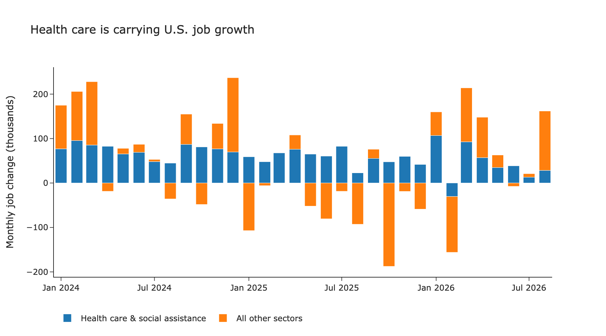
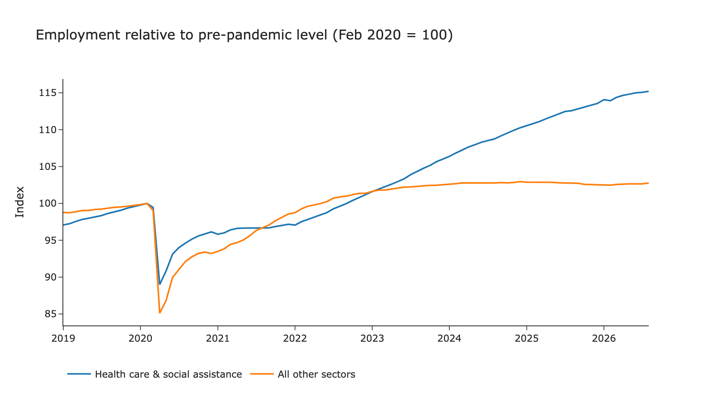
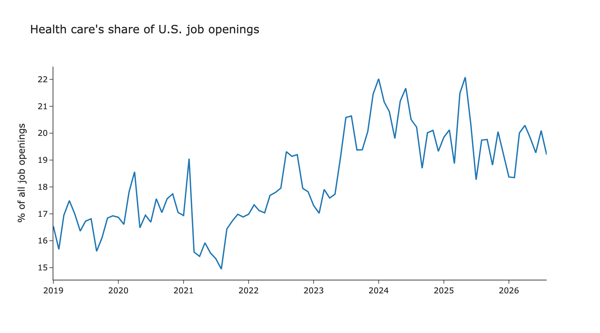

# Health Care Carried U.S. Job Growth. Its Engine Is Slowing.

*Data through August 2026 · Source: BLS Current Employment Statistics and JOLTS, via FRED*

## Key findings

- Since January 2024, health care and social assistance added **1.91 million jobs**, or **86%** of the 2.22 million jobs added across the U.S. economy.
- In 2025, health care added roughly **686,000 jobs** while all other sectors combined **lost about 570,000**.
- Health care's hiring pace has cooled, from an average of **74,000 jobs a month** in 2024 to about **27,000 a month** over June–August 2026.

## One sector, most of the gains

Headline payroll numbers since 2024 have looked modest but positive. Split them into health care and everything else, and a different picture emerges.



Health care posted gains in almost every month, while the rest of the economy swung between gains and losses. 2025 is the starkest case: without health care, the U.S. would have recorded a net job loss for the year.

## Two diverging recoveries

Indexing employment to its pre-pandemic level (February 2020) shows how long this divergence has been building.



Both groups had recovered their pandemic losses by 2022. After that, their paths split. Employment outside health care has been essentially flat since 2024, sitting about 3% above its pre-pandemic level. Health care kept climbing and is now roughly 15% above. That steady rise is consistent with demand drivers such as an aging population, which do not move with the business cycle the way sectors like retail or manufacturing do.

## Demand is still there, but cooling

Health care's weight in the labor market shows up in hiring demand too. Its share of all U.S. job openings rose from about 16–17% before 2022 to roughly 20% today: one in five openings.



Yet the underlying momentum is fading. Health care openings fell from 1.54 million in April 2026 to 1.36 million in August. Monthly job gains in the sector slowed from 74,000 on average in 2024 to 43,000 in January–August 2026, and to 27,000 over the most recent three months.

## So what?

For the past two years, the resilience of the U.S. labor market has largely been a health care story. If health care hiring keeps slowing, the key question is which sector picks up the slack. There are some early signs of broadening: sectors outside health care added 134,000 jobs in August. But one month is not a trend, and the cushion health care has provided is clearly thinning. The next few jobs reports will show whether growth spreads across sectors or whether total payroll gains drift toward zero.

## Data & methods

| Series | FRED ID | Description |
|---|---|---|
| Total employment | `PAYEMS` | All employees, total nonfarm (SA, thousands) |
| Health care employment | `CES6562000001` | All employees, health care and social assistance (SA, thousands) |
| Total job openings | `JTSJOL` | JOLTS job openings, total nonfarm (SA, thousands) |
| Health care job openings | `JTS6200JOL` | JOLTS job openings, health care and social assistance (SA, thousands) |

"All other sectors" is defined as total nonfarm employment minus health care and social assistance. The sample runs from January 2019 to August 2026.

**Limitations**

- The most recent months of BLS data are preliminary and are routinely revised, including through annual benchmark revisions.
- The health care series includes social assistance, so it is broader than health care alone.
- CES is an establishment survey: it counts jobs, not people.
- This analysis is descriptive and does not identify causes.

## Reproduce

```
labor-market-healthcare/
├── README.md
├── notebooks/analysis.ipynb   # data download, cleaning, analysis, charts
├── data/raw_fred.csv          # raw data pulled from FRED
└── figures/                   # exported charts
```

Requirements: Python 3, pandas, plotly, kaleido. Open `notebooks/analysis.ipynb` and run all cells; data is downloaded directly from FRED.
